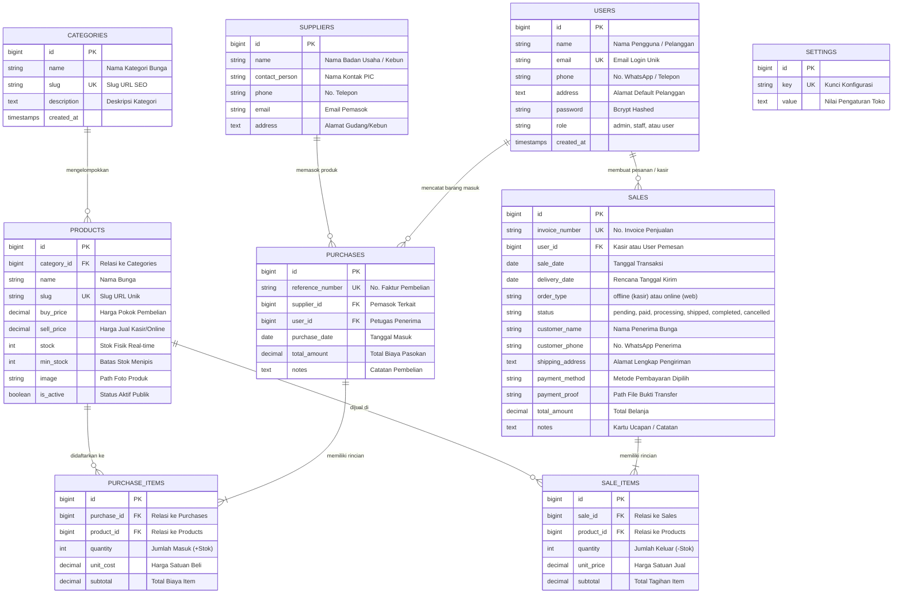

# 🌸 BLOOM MOMENT — Integrated Laravel Inventory & Online Sales Management System 
> Dibuat dengan arsitektur **Laravel MVC**, database relasional **MySQL (XAMPP)**, dan antarmuka **Blade Templating** dengan estetika natural butik bunga.

---

## Ringkasan Proyek

**Bloom Moment** adalah sistem manajemen inventaris dan penjualan kasir/online terintegrasi untuk butik bunga. Sistem memadukan **katalog publik belanja online untuk pelanggan (Role User)** dengan **sistem backoffice internal untuk staf dan admin**. Sistem ini dirancang untuk memastikan **konsistensi stok fisik secara atomik** (`DB::transaction` & `Product::lockForUpdate()`), integritas data relasional antar-tabel, pembatasan akses berbasis peran (*Role-Based Access Control*), serta alur transaksi online lengkap dengan beragam metode pembayaran.

---

## Akun Demo Pengujian

Sistem telah dilengkapi dengan 3 jenis akun bawaan (*seeder*):

| Peran (Role) | Alamat Email | Kata Sandi | Kewenangan & Hak Akses |
| :--- | :--- | :--- | :--- |
| **Admin / Owner** | `admin@bloommoment.com` | `admin123` | **Akses Penuh:** Kelola Pengguna & Peran (Admin/Staff/User), Kategori Bunga, Produk & Harga Pokok, Pemasok, Transaksi Pembelian/Restok (+Stok), Penjualan Kasir POS (-Stok), Pembatalan Transaksi Aman, Laporan Eksekutif, Verifikasi Bukti Transfer & Status Pesanan Online, dan Pengaturan Toko. |
| **Staff Florist** | `staff@bloommoment.com` | `staff123` | **Operasional Kasir & Pesanan:** Kelola harga jual & stok produk, lihat data supplier, input Penjualan Kasir POS (-stok), pantau pesanan online masuk dari pelanggan, perbarui status pesanan online (Dirangkai/Dikirim), dan cetak struk nota kasir. |
| **User (Pelanggan)** | `user@bloommoment.com` | `user123` | **Pembeli Online:** Login akun, melihat katalog bunga, mengelola Keranjang Belanja (`/cart`), Checkout pesanan bunga (`/checkout`), memilih metode pembayaran (Transfer Bank, QRIS, Virtual Account, COD), mengunggah bukti transfer, melihat riwayat pesanan (`/my-orders`), dan mencetak struk invoice. |
| **Pelanggan Publik** | *(Tanpa Login)* | *(Tanpa Password)* | Melihat Beranda, Katalog Bunga, Filter Kategori, Pencarian Bunga, Informasi Detail Bunga, Tentang Kami, dan melakukan pendaftaran akun baru (`/register`). |

---

## Persyaratan Lingkungan (*Prerequisites*)

1. **PHP**: Versi 8.2 atau lebih baru (dengan ekstensi `pdo_mysql`, `mbstring`, `openssl`, `fileinfo` aktif).
2. **Web Server & Database**: XAMPP (Apache & MySQL / MariaDB).
3. **Dependency Manager**: Composer v2.x.
4. **Browser**: Google Chrome, Mozilla Firefox, atau Microsoft Edge.

---

## Panduan Instalasi & Menjalankan Aplikasi (Environment Bersih)

Jika Anda menyalin atau melakukan *clone* proyek ini ke komputer/environment baru yang bersih, ikuti langkah-langkah berikut:

### 1. Salin Proyek & Masuk ke Direktori
```powershell
git clone <url-repository>
cd "Bloom Moment"
```

### 2. Pasang Dependensi Composer
```powershell
composer install
```

### 3. Siapkan File Environment & Generate Application Key
Salin file template `.env.example` menjadi `.env`, lalu generate encryption key Laravel:
```powershell
copy .env.example .env
php artisan key:generate
```
*(Di sistem Linux / macOS, gunakan `cp .env.example .env`)*.

### 4. Nyalakan Web Server & Database (XAMPP)
1. Buka **XAMPP Control Panel**.
2. Klik tombol **Start** pada modul **Apache** dan **MySQL** hingga indikator keduanya berwarna hijau.
3. Buat database baru bernama `bloom_moment_db` melalui phpMyAdmin (`http://localhost/phpmyadmin`) atau biarkan Laravel membuatnya secara otomatis saat migrasi.

### 5. Konfigurasi Koneksi Database (.env)
Buka file `.env` di direktori proyek dan pastikan konfigurasi mengarah ke database MySQL Anda:
```env
DB_CONNECTION=mysql
DB_HOST=127.0.0.1
DB_PORT=3306
DB_DATABASE=bloom_moment_db
DB_USERNAME=root
DB_PASSWORD=
```

### 6. Migrasi Tabel & Seeding Data Awal
Jalankan perintah migrasi dan pengisian data demo bawaan (akun demo admin/staff/user, kategori, supplier, produk, dan sampel transaksi kasir serta online):
```powershell
php artisan migrate:fresh --seed
```

### 7. Buat Tautan Penyimpanan (*Storage Symlink*)
Hubungkan direktori publik ke penyimpanan berkas untuk menampilkan foto produk, logo toko, dan bukti transfer pembayaran pelanggan:
```powershell
php artisan storage:link
```

### 8. Jalankan Server Lokal
```powershell
php artisan serve
```
Buka peramban (*browser*) dan akses: **`http://127.0.0.1:8000`**

---

## Struktur Database & Entity Relationship Diagram (ERD)

Sistem menggunakan **8 tabel inti relasional** (ditambah tabel `settings` untuk konfigurasi branding):

### Diagram ERD (Entity Relationship Diagram)



### Penjelasan 8 Tabel Inti:

1. **`users`**: Menyimpan akun pengguna dengan kolom `role` (`admin`, `staff`, atau `user`), nomor telepon, dan alamat tempat tinggal.
2. **`categories`**: Kategori bunga (misal: *Fresh Cut Flowers*, *Hand Bouquet*, *Flower Box*, *Dried & Preserved*, *Table Vase Arrangement*).
3. **`products`**: Data inventaris bunga (`name`, `slug`, `category_id`, `buy_price`, `sell_price`, `stock`, `min_stock`, `image`, `is_active`).
4. **`suppliers`**: Data pemasok/perkebunan bunga mitra toko.
5. **`purchases`**: Header transaksi barang masuk (No. referensi, tanggal, ID supplier, ID petugas, total biaya).
6. **`purchase_items`**: Detail item bunga masuk (`purchase_id`, `product_id`, `quantity`, `unit_cost`, `subtotal`).
7. **`sales`**: Header transaksi penjualan toko maupun online web (No. invoice `INV-` atau `INV-ONL-`, kanal `order_type`, status pesanan, nama dan kontak penerima, alamat pengiriman, metode pembayaran, bukti transfer, total tagihan).
8. **`sale_items`**: Detail item bunga terjual (`sale_id`, `product_id`, `quantity`, `unit_price`, `subtotal`).

---

## Aturan Bisnis & Konsistensi Stok (Atomisitas)

1. **Pembelian / Restock Bunga (Barang Masuk)**:
   - Dilakukan di menu **Pembelian (Masuk)** oleh Admin / Staff.
   - Menggunakan `DB::beginTransaction()`.
   - Total dihitung ulang di server (`qty * unit_cost`) untuk mencegah manipulasi form.
   - Stok fisik produk bertambah otomatis: `stock = stock + quantity`.
   - Harga pokok beli produk terbarui otomatis sesuai nota supplier terbaru.

2. **Penjualan Kasir POS (Offline)**:
   - Dibuat melalui antarmuka kasir di menu **Penjualan (Kasir)** oleh Staff maupun Admin.
   - Menggunakan `Product::lockForUpdate()` saat pengecekan stok untuk mencegah kondisi balapan (*race condition*).
   - **Validasi Stok Ketat**: Kuantitas tidak boleh melebihi stok yang ada (`stock >= quantity`).
   - Stok fisik berkurang otomatis: `stock = stock - quantity`.

3. **Pembelian Online oleh Role User**:
   - Pelanggan mendaftar akun (`/register`) dan login (`/login`) dengan role `user`.
   - Bunga dapat ditambahkan ke **Keranjang Belanja** (`/cart`) dengan kontrol jumlah tangkai.
   - Pada halaman **Checkout** (`/checkout`), pelanggan memasukkan nama penerima, no. WhatsApp, alamat pengiriman, tanggal kirim, dan catatan kartu ucapan bunga.
   - Memilih salah satu dari metode pembayaran:
     - **Transfer Bank**: BCA, Mandiri, BNI, BRI (dengan nomor rekening resmi dan tombol salin).
     - **QRIS & E-Wallet**: Scan barcode QRIS (GoPay, OVO, DANA, ShopeePay, m-Banking).
     - **Virtual Account (VA)**: BCA VA & Mandiri VA instan.
     - **Cash on Delivery (COD)**: Bayar tunai ke kurir saat bunga diterima.
   - Menggunakan `lockForUpdate()`, stok fisik bunga langsung diamankan dan berkurang otomatis saat order dibuat.
   - Invoice unik `INV-ONL-YYYYMM-XXXX` terbit, dan pelanggan dapat mengunggah bukti transfer pada halaman detail pesanan.

4. **Integritas Penghapusan (Foreign Key Restrict)**:
   - Produk, pengguna, atau supplier yang sudah memiliki riwayat transaksi **tidak dapat dihapus** sembarangan untuk menjaga keutuhan audit laporan keuangan.

5. **Pembatalan Transaksi Aman**:
   - Khusus Admin/Owner, transaksi penjualan dapat dibatalkan di mana seluruh stok fisik bunga dikembalikan (*increment*) ke sistem secara terkontrol.

---

## Skenario Pengujian untuk Sidang / Evaluasi

| No | Skenario Uji | Langkah Pengujian | Hasil yang Diharapkan | Status |
| :---: | :--- | :--- | :--- | :---: |
| 1 | **Akses Publik Tanpa Login** | Buka URL `/`, `/catalog`, `/about`, `/contact`. | Halaman terbuka lancar, katalog bunga dapat dilihat publik. | ✅ Berhasil |
| 2 | **Registrasi Pelanggan Baru** | Buka `/register`, isi formulir pendaftaran pelanggan baru. | Akun terdaftar dengan role `user`, otomatis login, dan dialihkan ke beranda. | ✅ Berhasil |
| 3 | **Login Role User (Pelanggan)** | Buka `/login`, klik demo akun `user@bloommoment.com` (pass: `user123`). | Masuk lancar, diarahkan ke toko publik dengan sapaan nama dan menu *Pesanan Saya*. | ✅ Berhasil |
| 4 | **Proteksi Backoffice dari Role User** | Saat login sebagai Pelanggan (role `user`), coba buka `/admin/dashboard`. | Akses ditolak, otomatis dialihkan kembali ke beranda dengan peringatan. | ✅ Berhasil |
| 5 | **Keranjang Belanja (*Cart*)** | Pilih bunga di katalog &rarr; klik *Tambah ke Keranjang* atau *Beli Sekarang*. | Bunga masuk ke keranjang, kuantitas dapat diubah, badge jumlah di navbar terbarui. | ✅ Berhasil |
| 6 | **Checkout & Pemilihan Pembayaran** | Lanjut ke Checkout &rarr; isi data penerima & pilih metode (Transfer BCA / QRIS / COD). | Order berhasil dibuat, invoice `INV-ONL-` terbit, dan stok bunga berkurang otomatis. | ✅ Berhasil |
| 7 | **Panduan Pembayaran & Salin Rekening** | Buka halaman pesanan yang baru dibuat. | Rekening resmi (BCA/Mandiri/QRIS) tampil lengkap dengan tombol salin dan nominal tagihan. | ✅ Berhasil |
| 8 | **Unggah Bukti Transfer** | Unggah file foto bukti transfer pada halaman pesanan. | Bukti tersimpan aman, thumbnail tampil, status pesanan berubah menjadi *Sudah Bayar*. | ✅ Berhasil |
| 9 | **Riwayat Pesanan Pelanggan** | Buka menu *Pesanan Saya* (`/my-orders`). | Daftar transaksi online tampil rapi dengan badge status dan tombol lihat invoice/struk. | ✅ Berhasil |
| 10 | **Verifikasi Backoffice Staf/Admin** | Login Admin/Staff &rarr; buka menu *Penjualan (Kasir)*. | Pesanan online tampil dengan badge kanal `🌐 Online`, staf dapat melihat bukti transfer & mengubah status. | ✅ Berhasil |
| 11 | **Login & Otorisasi Staff** | Login dengan `staff@bloommoment.com`. | Masuk ke dashboard operasional kasir. Menu Kategori, User, dan Pengaturan tersembunyi. | ✅ Berhasil |
| 12 | **Penolakan Stok Minus** | Coba lakukan checkout/penjualan melebihi sisa stok fisik bunga. | Transaksi ditolak, sistem mencegah stok menjadi minus. | ✅ Berhasil |
| 13 | **Laporan Rekapitulasi** | Masuk menu Laporan &rarr; Filter tanggal &rarr; Cetak. | Laporan gabungan penjualan kasir, pembelian restok, dan laba kotor tampil akurat. | ✅ Berhasil |

---

## Menjalankan Pengujian Otomatis (*Automated Testing*)

Sistem telah dilengkapi dengan test suite lengkap berbasis PHPUnit:
```powershell
php artisan test
```
Hasil: **22 Tests Passed (93 Assertions)** mencakup:
- `Tests\Unit\ExampleTest`
- `Tests\Feature\ExampleTest`
- `Tests\Feature\InventoryAndSalesTest` (12 pengujian kasir, restok, otorisasi peran, filter tanggal, dan laporan)
- `Tests\Feature\UserRoleAndOnlinePurchaseTest` (9 pengujian registrasi user, login user, proteksi backoffice, keranjang belanja, checkout online, verifikasi berbagai metode pembayaran seperti Transfer Bank, E-Wallet, VA, Minimarket, upload bukti transfer, dan pembaruan status pesanan)

---

## Struktur File Penting Proyek

- **Model & Relasi**: `app/Models/` (`User`, `Category`, `Product`, `Supplier`, `Purchase`, `PurchaseItem`, `Sale`, `SaleItem`, `Setting`).
- **Controller Pengguna & Pembelian Online**:
  - `app/Http/Controllers/AuthController.php` (Login & Registrasi role `user`)
  - `app/Http/Controllers/CartController.php` (Pengelolaan keranjang belanja)
  - `app/Http/Controllers/CheckoutController.php` (Checkout online & metode pembayaran)
  - `app/Http/Controllers/OrderController.php` (Detail pesanan pelanggan, upload bukti transfer & cetak invoice)
- **Controller Backoffice**:
  - `app/Http/Controllers/DashboardController.php`
  - `app/Http/Controllers/ProductController.php`
  - `app/Http/Controllers/CategoryController.php`
  - `app/Http/Controllers/SupplierController.php`
  - `app/Http/Controllers/PurchaseController.php`
  - `app/Http/Controllers/SaleController.php` (Mendukung penjualan Kasir POS & pembaruan status pesanan Online)
  - `app/Http/Controllers/ReportController.php`
  - `app/Http/Controllers/UserController.php`
- **Middleware**: `app/Http/Middleware/RoleMiddleware.php`.
- **Rute Web**: `routes/web.php`.
- **Tampilan Blade Publik & Belanja Online**:
  - `resources/views/public/home.blade.php`
  - `resources/views/public/catalog.blade.php`
  - `resources/views/public/detail.blade.php`
  - `resources/views/public/cart.blade.php` (Keranjang belanja)
  - `resources/views/public/checkout.blade.php` (Checkout & pemilihan metode pembayaran)
  - `resources/views/public/orders/index.blade.php` (Riwayat pesanan pelanggan)
  - `resources/views/public/orders/show.blade.php` (Detail tagihan, panduan bayar & upload bukti transfer)
  - `resources/views/public/orders/receipt.blade.php` (Struk siap cetak)
- **Tampilan Blade Autentikasi**:
  - `resources/views/auth/login.blade.php` (Login Admin, Staff, dan Pelanggan)
  - `resources/views/auth/register.blade.php` (Registrasi akun pelanggan baru)
- **Tampilan Blade Backoffice**: `resources/views/admin/` (`dashboard`, `categories/`, `products/`, `suppliers/`, `purchases/`, `sales/`, `reports/`, `users/`, `settings/`).
- **Desain CSS**: `public/css/style.css` (Palet natural toko bunga: Butter Cream, Sage Green, Dark Brown, Soft Lavender, Sky Blue, Dusty Pink).

---

*Selamat menggunakan dan menguji sistem Bloom Moment.* 🌸
